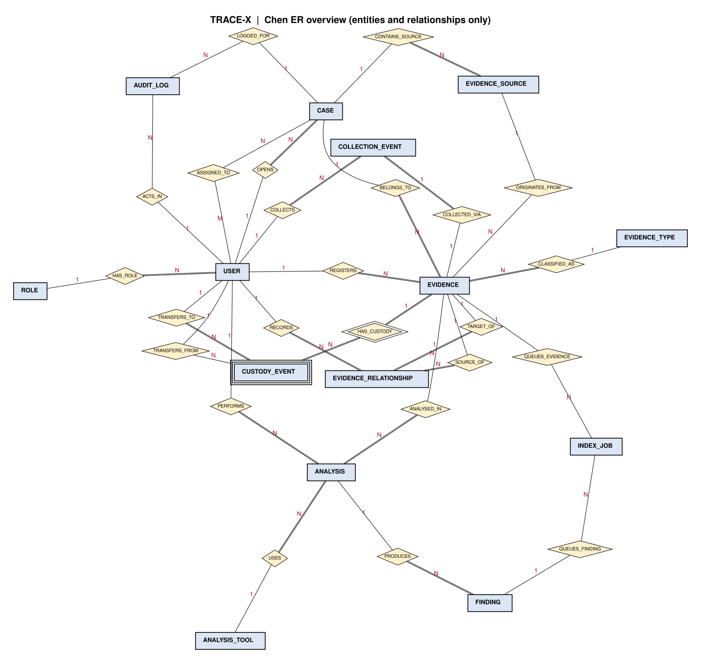

# TRACE-X: Final DBMS Project Report

> **Submission-ready draft; live evidence still required.** This report is grounded in the current repository and committed Phase 4 results. It deliberately does not invent screenshots or claim that the presentation Mac has passed live database/browser checks. Complete the verification record in Section 14 and attach the screenshots listed in the presentation checklist before submission.

## Project information

| Item | Details |
|---|---|
| Project title | TRACE-X — A Provenance-Aware Hybrid Relational–Vector Database for Digital Evidence Provenance and Semantic Correlation |
| Course | Database Management Systems |
| Institution | PES University |
| Team member 1 | Urav B S — PES1UG24CS507 |
| Team member 2 | Uttam B S — PES1UG24CS508 |
| Primary database | MySQL 8 |
| Vector database | Qdrant |
| Application | Next.js / React (JavaScript) |

## Abstract

TRACE-X is a database-backed digital-evidence provenance and semantic-retrieval system. MySQL stores authoritative users, roles, investigation cases, evidence records, collection events, custody history, analyses, findings, evidence relationships, audit events and indexing jobs. Qdrant stores compact vector representations of evidence and findings so investigators can search by meaning rather than relying only on exact keywords.

The design deliberately separates semantic discovery from authoritative decisions. Qdrant returns candidate matches; the application re-reads each candidate from MySQL and verifies case access, active status and content version before returning it. A similarity score is an investigative lead, not proof. An evidence relationship is recorded only when an analyst selects a relationship type and supplies a written rationale.

The repository contains a 15-table MySQL schema, role-based database access, stored procedures and triggers, a Qdrant indexing worker, authenticated semantic retrieval, a Next.js investigation workspace and a synthetic retrieval evaluation. This version stores evidence metadata, SHA-256, file size and extracted text. It does not store original binary files or disk images.

## 1. Introduction

Digital investigations can involve many files, logs and extracted records. Investigators need to know not only what an evidence item contains, but also where it came from, who collected it, who handled it, what analysis was performed and why it was linked to another item.

A relational database is suitable for exact records, relationships, permissions and provenance. However, exact keyword matching can miss records that describe the same activity using different words. A vector database can help retrieve semantically similar text, but it cannot safely decide case access, current custody, withdrawn status or formal evidence relationships.

TRACE-X combines the two approaches. MySQL remains the source of truth, while Qdrant is used to suggest semantic candidates. This lets the system support meaning-based search without allowing a vector similarity result to bypass database authorization or provenance rules.

## 2. Problem statement and objectives

**Problem statement:** Design and implement a provenance-aware database system that stores structured digital-evidence records, preserves custody and audit history, and supports semantic retrieval while enforcing case-scoped access and preventing similarity scores from being treated as verified relationships.

**Objectives**

1. Model users, roles, cases, assignments, evidence and provenance using a normalized relational schema.
2. Enforce integrity through primary keys, foreign keys, constraints, indexes, triggers and stored procedures.
3. Preserve chain-of-custody and audit history.
4. Support semantic search over evidence and findings using local embeddings and Qdrant.
5. Revalidate every vector candidate against MySQL before displaying it.
6. Provide administrator and investigator workflows through a Next.js interface.
7. Compare keyword, vector-only and hybrid retrieval on a reproducible synthetic dataset.

## 3. Scope and assumptions

The system stores evidence metadata, collection details, a SHA-256 hash, file size and extracted text. The current schema does **not** store original binary files or disk images. Binary-object storage would require a separate storage, access-control and integrity design.

Evidence and findings are the records selected for vectorization. Cases, users, sources, custody events and audit records remain relational because exact SQL operations are more suitable for them. Analysis notes are not embedded in this version.

The Phase 4 benchmark uses synthetic records, synthetic queries and relevance labels. Its metrics describe the benchmark setup; they are not evidence of effectiveness on real forensic casework.

## 4. System architecture

### 4.1 Main components

| Component | Responsibility |
|---|---|
| MySQL 8 | Authoritative users, roles, cases, evidence, custody, analysis, findings, relationships, audit and indexing jobs |
| Qdrant | Stores 384-dimensional vectors and minimal payload metadata for semantic candidate retrieval |
| BAAI/bge-small-en-v1.5 | Local embedding model for evidence/finding text and search queries |
| Next.js / React (JavaScript) | Authenticated workspace, server-rendered pages and API Route Handlers |
| Node indexing worker | Consumes the MySQL outbox and synchronizes Qdrant points |

### 4.2 Architecture and data flow

When evidence or finding text changes, MySQL updates the relational record and writes an indexing job in the same database transaction. The worker processes that job asynchronously and updates Qdrant. This avoids making a MySQL transaction depend on a separate vector-service request.

MySQL and Qdrant are therefore eventually consistent rather than one distributed transaction. Each record has a content version. Retrieval compares the Qdrant payload version with the current MySQL version and discards stale candidates.

## 5. Relational database design

### 5.1 Entity and table groups

The schema contains 15 tables:

| Group | Tables | Purpose |
|---|---|---|
| Identity and access | `role`, `app_user`, `case_assignment` | Roles, users and active/revoked case assignments |
| Case and evidence | `investigation_case`, `evidence_source`, `evidence_type`, `evidence` | Investigation cases and the evidence registered in them |
| Provenance and analysis | `collection_event`, `custody_event`, `analysis_tool`, `analysis`, `finding` | Collection, chain of custody, analyst work and findings |
| Relationships and operations | `evidence_relationship`, `audit_log`, `index_job` | Human-recorded links, audit history and vector-index work |

The Chen ER diagrams are stored under [docs/design/er/](design/er/). The original design, relationship catalogue and ER-to-relational mapping are in [TRACE-X Phase 2 Design](design/TRACE-X_Phase2_Design.md).

<figure>
  
  <figcaption>Figure 1. TRACE-X Chen ER overview. The detailed access, evidence/provenance and analysis/indexing diagrams are in docs/design/er/.</figcaption>
</figure>

### 5.2 Keys, constraints and normalization

The schema uses primary keys, foreign keys, unique constraints and CHECK constraints. `custody_event` is a weak entity identified by the composite primary key `(evidence_id, seq_no)`: a custody event is identified by the evidence item and its position in the custody sequence.

The many-to-many relationship between evidence records is represented through `evidence_relationship`, with two evidence foreign keys identifying the endpoints.

The design separates case, source, type, user and analysis-tool data so descriptive attributes are not repeatedly stored in evidence rows. For example, a source label is stored once in `evidence_source`. This reduces update anomalies and supports a 3NF design.

Important integrity rules include:

- An evidence source must belong to the same case as the evidence item.
- Both ends of an evidence relationship must belong to the same case.
- A custody transfer must follow the current holder and append the next sequence number.
- Custody and audit history are append-only.
- Evidence withdrawal is a soft delete; the provenance row remains.
- Changes to indexed text advance a content version and enqueue an indexing job.

### 5.3 Database objects and demonstration scripts

| File | Purpose |
|---|---|
| `database/01_schema.sql` | Tables, keys, constraints and indexes |
| `database/02_access.sql` | Session helper, investigator-filtered views, roles, grants and application accounts |
| `database/03_routines.sql` | Stored procedures, functions, triggers, extra views and procedure grants |
| `database/04_dml.sql` | Allowed and intentionally rejected DML examples |
| `database/05_queries.sql` | Joins, nested/correlated queries, window functions, recursive CTE and FULLTEXT |
| `database/06_verify_access.sql` | Access and privilege checks |
| `database/07_demo.sql` | Read-only database walkthrough |
| `database/08_verify_database.sql` | Read-only schema-object and seed verification |

## 6. Security, authorization and provenance

TRACE-X separates Administrator, Investigator and Worker MySQL roles and uses separate application accounts.

Investigators read through `v_my_*` views, which filter records using the authenticated user's active case assignments. They do not receive direct SELECT access to restricted base tables such as `app_user` and `custody_event`. Administrators use granted base tables and the application verifies that the session user still has the Administrator role. The indexing worker uses a separate account with the grants needed for indexing.

The database helper sets `@tracex_user_id` for each database request and clears it before a connection is returned to the pool. Stored procedures enforce case access, case status, current-custodian and authorship rules on writes.

Custody and audit records are append-only. Evidence is withdrawn rather than hard-deleted, preserving its provenance. Semantic similarity never creates an evidence relationship automatically; an analyst must choose the relationship type and record a written rationale.

## 7. Vector database and indexing design

### 7.1 Collection and payload

The Qdrant collection is `tracex_records`. It uses 384-dimensional cosine vectors. Point IDs are deterministic UUIDv5 values derived from `evidence:{evidence_id}` or `finding:{finding_id}`, so repeated upserts update the same point rather than creating duplicates.

The payload contains `kind`, `record_id`, `evidence_id`, `case_id` and `content_version`. It does not contain raw document text or user permissions.

### 7.2 Outbox processing

MySQL triggers enqueue `upsert` jobs when indexed text changes and `delete` jobs when evidence is withdrawn. The single indexing worker:

1. Claims pending jobs using a compare-and-set update.
2. Reads authoritative evidence/finding text from MySQL.
3. Creates an embedding with BGE-small.
4. Upserts or deletes the deterministic Qdrant point.
5. Updates indexing bookkeeping and marks the job complete.

The worker includes retry, failure and interrupted-job recovery behavior. The current schema does not contain lease/claim-token columns, so the supported operating model is one worker process at a time.

### 7.3 Stale and withdrawn record protection

Retrieval does not trust the Qdrant payload as an authorization source. It re-reads each candidate from MySQL using the investigator-filtered views or administrator base-table path. Missing, inaccessible, out-of-scope, withdrawn and stale candidates are discarded. Both investigator views expose `content_version`, so stale-version validation applies to both roles.

## 8. Application workflows

The Next.js workspace provides:

- Login and role-aware navigation.
- Dashboard with live case/evidence counts and recent custody activity.
- Administrator case creation, case status changes and case-assignment grant/revoke controls.
- Case details and per-evidence chain-of-custody timeline.
- Evidence metadata registration, collection details and evidence detail pages.
- Custody transfer to another active teammate, subject to current-custodian and open-case rules.
- Analysis start/completion and finding creation.
- Human-recorded evidence relationships with a written rationale.
- Semantic search with optional case scope, record type and result count.
- Administrator audit history, Qdrant point inspection and missing/stale vector queue controls.

The evidence registration form records metadata and extracted text; it is not a binary-file upload screen. Evidence metadata edits preserve the stored extracted text inside MySQL and queue a new vector version. Withdrawal preserves the relational provenance row and queues Qdrant point deletion.

## 9. Retrieval evaluation

### 9.1 Experimental setup

The Phase 4 experiment compares MySQL FULLTEXT keyword retrieval, vector-only retrieval and Reciprocal Rank Fusion (RRF) hybrid retrieval.

| Parameter | Value |
|---|---|
| Corpus sizes | 500 and 2,000 synthetic evidence records |
| Queries | 40 per dataset; 34 answerable |
| Cases | 40 |
| Top K | 10 |
| Hybrid configuration | RRF constant 60; top 50 from each source |
| Embedding model | BAAI/bge-small-en-v1.5 |
| MySQL | 8.0.46 |
| Timed passes | 1 warm-up and 5 measured passes |
| Confidence intervals | Paired bootstrap, 10,000 resamples |

Precision@10, Recall@10 and F1@10 use grade-2 relevance. MRR and MAP measure the ranking of fully relevant records. NDCG@10 uses graded relevance. The full definitions, confidence intervals, per-category results and latency breakdown are in [the generated Phase 4 report](../evaluation/results/REPORT.md).

### 9.2 Ranking results

**500-record dataset**

| Method | Precision@10 | Recall@10 | F1@10 | MRR | MAP | NDCG@10 |
|---|---:|---:|---:|---:|---:|---:|
| Keyword | 0.294 | 0.368 | 0.327 | 0.670 | 0.309 | 0.451 |
| Vector-only | 0.479 | 0.599 | 0.533 | 0.853 | 0.540 | 0.678 |
| Hybrid | 0.424 | 0.529 | 0.471 | 0.855 | 0.459 | 0.610 |

**2,000-record dataset**

| Method | Precision@10 | Recall@10 | F1@10 | MRR | MAP | NDCG@10 |
|---|---:|---:|---:|---:|---:|---:|
| Keyword | 0.268 | 0.335 | 0.297 | 0.645 | 0.292 | 0.418 |
| Vector-only | 0.456 | 0.570 | 0.507 | 0.847 | 0.515 | 0.655 |
| Hybrid | 0.379 | 0.474 | 0.422 | 0.813 | 0.418 | 0.562 |

### 9.3 Interpretation

Vector-only led hybrid on Precision@10, Recall@10, F1@10, MAP and NDCG@10 at both dataset sizes. Hybrid narrowly led MRR on the 500-record dataset (0.855 versus 0.853), while vector-only led MRR on the 2,000-record dataset (0.847 versus 0.813). Hybrid outperformed keyword in these runs, but it was not universally better than vector-only.

Warm median latency was lowest for keyword search. At 500 records, warm medians were 6.6 ms (keyword), 34.6 ms (vector-only) and 47.4 ms (hybrid). At 2,000 records, they were 7.3 ms, 34.5 ms and 47.8 ms respectively. First-call measurements are not independent cold-start results; the report explicitly does not claim a cold-start measurement.

The evaluation corpus contains evidence records only. The application worker supports finding indexing, but findings are outside this benchmark's dataset and ranking metrics.

## 10. Technology justification

MySQL handles structured records, constraints, transactions, permissions and provenance. Qdrant handles nearest-neighbour vector search. The BGE-small model creates compact local embeddings. Next.js provides the authenticated UI and APIs in the same JavaScript ecosystem as the worker and embedding libraries. The MySQL outbox makes vector updates asynchronous and recoverable.

The trade-off is deliberate: MySQL and Qdrant are eventually consistent rather than one distributed transaction. The content-version mechanism, deterministic point IDs and worker retries make that boundary explicit. See [Technology Justification](TECHNOLOGY_JUSTIFICATION.md) for the full comparison and trade-offs.

## 11. Limitations and future work

- The benchmark is synthetic, uses 40 queries written by one author and does not demonstrate effectiveness on real forensic casework.
- The evaluation corpus contains evidence records only; finding records are outside the experiment.
- Original binary files are not stored. The current evidence form records metadata, hash, size and extracted text.
- Text beyond the model's 512-token input limit is truncated; chunking is a future enhancement.
- The current schema supports one worker process because it has no lease/claim-token mechanism.
- Live browser walkthroughs, local MySQL/Qdrant checks and presentation screenshots must be recorded against the presentation environment.
- The final report should be updated with the actual verification output and screenshots before submission.

## 12. Conclusion

TRACE-X combines relational integrity and provenance with semantic retrieval. MySQL remains the authoritative store for identity, case scope, evidence status, custody, audit and relationships. Qdrant improves discovery by returning semantically similar candidates, but MySQL validates those candidates before display. The outbox worker keeps the vector index synchronized without placing vector-service operations inside relational transactions.

The committed synthetic benchmark shows vector-only retrieval outperforming the tested RRF hybrid configuration on most principal ranking metrics, while keyword retrieval has the lowest warm latency. These results provide a reproducible comparison for the chosen synthetic dataset; they should not be generalized to real forensic investigations without further evaluation.

## 13. Repository deliverables

| Deliverable | Repository location |
|---|---|
| Chen ER diagrams and generator | `docs/design/er/` |
| Relational design and normalization | `docs/design/TRACE-X_Phase2_Design.md` |
| Technology rationale | `docs/TECHNOLOGY_JUSTIFICATION.md` |
| MySQL schema, access control and routines | `database/01_schema.sql` through `database/08_verify_database.sql` |
| Fictional dataset and seed data | `data/` |
| Qdrant setup/health and vector module | `vector/`, `app/src/lib/vector/` |
| Indexing worker | `worker/`, `app/src/lib/indexing/` |
| Retrieval API and semantic search | `app/src/lib/retrieval/`, `app/src/app/api/search/semantic/` |
| Next.js workspace and write workflows | `app/src/app/(workspace)/`, `app/src/app/api/workspace/` |
| Phase 4 evaluation code and result artifacts | `evaluation/` |
| Setup and API documentation | `docs/SETUP.md`, `docs/api-contract.md` |
| Rubric cross-reference | `docs/EVALUATION_RUBRIC_MAP.md` |

## 14. Verification record — complete before submission

Do not mark a row as passed until the command has been run against the intended presentation environment and the output has been saved.

| Check | Command / evidence | Result / date |
|---|---|---|
| Schema and seed verification | `mysql -u root -p < database/08_verify_database.sql` | **To be completed on presentation database** |
| Read-only SQL walkthrough | `database/07_demo.sql` | **To be completed** |
| DDL/DML/query demonstrations | `database/05_queries.sql`, then `database/04_dml.sql` separately | **To be completed** |
| Investigator RBAC | `database/06_verify_access.sql` and live permission test | **To be completed** |
| MySQL live tests | `npm run test:db:live`, `npm run test:auth:live`, `npm run test:retrieval:live`, `npm run test:indexing:live` from `app/` | **To be completed on local MySQL** |
| Qdrant live test | `npm run test:vector:live` from `app/` | **To be completed on local Qdrant** |
| Production build | `npm run build` from `app/` | Previous local build passed before PR #7/#8; rerun after syncing final main |
| Browser workflow | Checklist in `docs/PRESENTATION_EVIDENCE_CHECKLIST.md` | **Screenshots to be added** |
| Final report | This document | Draft complete; append real verification output and screenshots |
