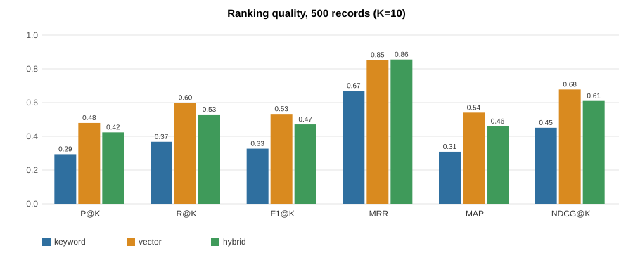
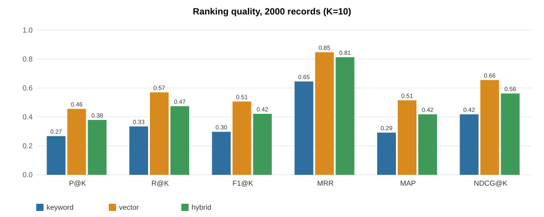
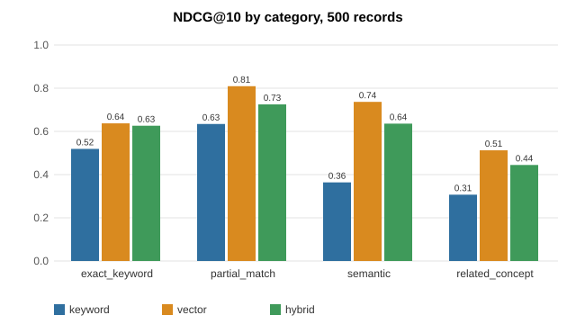
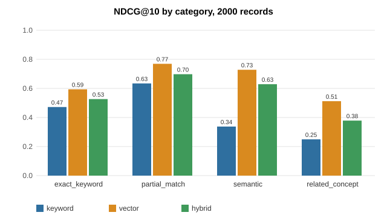
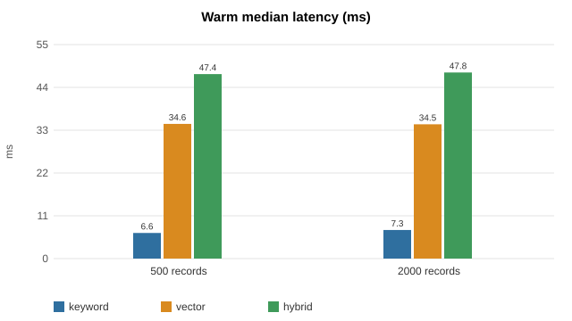

# TRACE-X Phase 4: Retrieval Evaluation Report

> Generated by `evaluation/scripts/report.mjs` from the results files only. Nothing in this document was typed in by hand except the fixed definitions and limitations.

## 1. What was run

| Size | Records | Queries (answerable) | Cases | Run finished | MySQL | Embedding model | Seed |
|---|---|---|---|---|---|---|---|
| 500 | 500 | 40 (34) | 40 | 2026-11-14T15:49:23.102Z | 8.0.46 | BAAI/bge-small-en-v1.5 | 20260509 |
| 2000 | 2000 | 40 (34) | 40 | 2026-11-14T15:55:19.711Z | 8.0.46 | BAAI/bge-small-en-v1.5 | 20260509 |

Configuration: K=10; hybrid = Reciprocal Rank Fusion (k=60) over the top 50 of the keyword and vector lists; 1 warm-up pass, 5 timed passes over all queries; bootstrap 10000 resamples (seed 424242).

MySQL FULLTEXT settings during the run: innodb_ft_min_token_size=3, innodb_ft_enable_stopword=1. Defaults were used and not tuned.

## 2. Metric definitions

- **Relevance.** Each query has graded labels: 2 = the record belongs to the event the query asks about, 1 = it belongs to a related forensic concept, 0 = not relevant. "Relevant" for Precision, Recall, F1, MRR and MAP means grade 2 (a lenient grade >= 1 view is in section 4). NDCG uses the grades.
- **Precision@10** = relevant records in the top 10 / 10. **Recall@10** = relevant in the top 10 / all relevant records. **F1@10** = harmonic mean of the two, computed per query, then averaged.
- **MRR** = mean of 1 / rank of the first relevant record (0 if none in the top 10). **MAP** = mean of AP@10, where AP@10 = sum of Precision@i at each relevant rank i <= 10, divided by min(number of relevant, 10).
- **NDCG@10** = DCG / ideal DCG with linear gain (the grade) and a log2(rank + 1) discount.
- **Aggregation.** Macro average over answerable queries (each query counts once). No-answer queries have no relevant record, so they are excluded from those means and reported in section 5.
- **Duplicates.** A record counts once per ranking; every list is de-duplicated before scoring.
- **Latency.** Wall-clock milliseconds for one search call, measured in the evaluation process (MySQL and Qdrant round trips and, for vector and hybrid, query embedding included). **Warm** = all queries of the timed passes after a full warm-up pass. **First call (in process)** = the first call of a method inside the main run; the methods run one after another in the same process, so this is NOT an independent cold start. **Cold start (fresh process)** = the first search call of a brand-new Node process, measured by separate probes (section 6, only if `cold.mjs` was run).

## 3. Ranking quality

### 500 records

| Method | P@10 | R@10 | F1@10 | MRR | MAP | NDCG@10 |
|---|---|---|---|---|---|---|
| keyword | 0.294 | 0.368 | 0.327 | 0.670 | 0.309 | 0.451 |
| vector | 0.479 | 0.599 | 0.533 | 0.853 | 0.540 | 0.678 |
| hybrid | 0.424 | 0.529 | 0.471 | 0.855 | 0.459 | 0.610 |

### 2000 records

| Method | P@10 | R@10 | F1@10 | MRR | MAP | NDCG@10 |
|---|---|---|---|---|---|---|
| keyword | 0.268 | 0.335 | 0.297 | 0.645 | 0.292 | 0.418 |
| vector | 0.456 | 0.570 | 0.507 | 0.847 | 0.515 | 0.655 |
| hybrid | 0.379 | 0.474 | 0.422 | 0.813 | 0.418 | 0.562 |

## 4. By query category and lenient relevance

### 500 records: NDCG@10 / Recall@10 per category

| Category | Queries | keyword NDCG / R | vector NDCG / R | hybrid NDCG / R | Leader (NDCG) |
|---|---|---|---|---|---|
| exact_keyword | 8 | 0.519 / 0.422 | 0.637 / 0.547 | 0.626 / 0.563 | vector |
| partial_match | 8 | 0.634 / 0.484 | 0.809 / 0.734 | 0.725 / 0.625 | vector |
| semantic | 10 | 0.364 / 0.338 | 0.737 / 0.725 | 0.636 / 0.588 | vector |
| related_concept | 8 | 0.307 / 0.234 | 0.512 / 0.359 | 0.445 / 0.328 | vector |

Lenient relevance (grade >= 1), 500 records:

| Method | P@10 | R@10 | MRR | MAP |
|---|---|---|---|---|
| keyword | 0.329 | 0.347 | 0.705 | 0.330 |
| vector | 0.538 | 0.574 | 0.934 | 0.585 |
| hybrid | 0.462 | 0.499 | 0.908 | 0.483 |

### 2000 records: NDCG@10 / Recall@10 per category

| Category | Queries | keyword NDCG / R | vector NDCG / R | hybrid NDCG / R | Leader (NDCG) |
|---|---|---|---|---|---|
| exact_keyword | 8 | 0.472 / 0.375 | 0.594 / 0.500 | 0.527 / 0.453 | vector |
| partial_match | 8 | 0.634 / 0.484 | 0.769 / 0.672 | 0.698 / 0.578 | vector |
| semantic | 10 | 0.338 / 0.300 | 0.728 / 0.713 | 0.629 / 0.575 | vector |
| related_concept | 8 | 0.249 / 0.188 | 0.512 / 0.359 | 0.378 / 0.266 | vector |

Lenient relevance (grade >= 1), 2000 records:

| Method | P@10 | R@10 | MRR | MAP |
|---|---|---|---|---|
| keyword | 0.294 | 0.317 | 0.680 | 0.304 |
| vector | 0.515 | 0.544 | 0.928 | 0.560 |
| hybrid | 0.415 | 0.451 | 0.866 | 0.443 |

## 5. Queries with no relevant record

Ideal behaviour is to return nothing (or nothing confident). A method that always returns K results cannot express "no answer" without a score threshold, which this evaluation deliberately does not add.

| Size | Method | No-answer queries | Returned any result | Mean results returned |
|---|---|---|---|---|
| 500 | keyword | 6 | 4 | 6.7 |
| 500 | vector | 6 | 6 | 10.0 |
| 500 | hybrid | 6 | 6 | 10.0 |
| 2000 | keyword | 6 | 4 | 6.7 |
| 2000 | vector | 6 | 6 | 10.0 |
| 2000 | hybrid | 6 | 6 | 10.0 |

## 6. Latency (milliseconds)

| Size | Method | First call (in process) | Warm mean | Warm median | Warm p95 | Warm samples |
|---|---|---|---|---|---|---|
| 500 | keyword | 15.2 | 7.2 | 6.6 | 9.9 | 200 |
| 500 | vector | 1375.5 | 37.9 | 34.6 | 54.1 | 200 |
| 500 | hybrid | 52.3 | 49.4 | 47.4 | 63.6 | 200 |
| 2000 | keyword | 16.0 | 7.6 | 7.3 | 10.8 | 200 |
| 2000 | vector | 1012.0 | 35.2 | 34.5 | 42.1 | 200 |
| 2000 | hybrid | 73.8 | 49.0 | 47.8 | 59.8 | 200 |

First-call numbers are single samples taken after earlier methods had already opened connections and loaded the model (hybrid runs last), so they understate a true cold start. Independent cold starts are below when available.

Mean time per stage, 500 records:

| Method | Stages (ms) |
|---|---|
| vector | embed_ms=10.8, qdrant_ms=8.2, mysql_ms=18.5 |
| hybrid | keyword_ms=7.6, vector_ms=41.5, fuse_ms=0.3, vector_embed_ms=10.7, vector_qdrant_ms=11.0, vector_mysql_ms=18.3 |

Mean time per stage, 2000 records:

| Method | Stages (ms) |
|---|---|
| vector | embed_ms=10.4, qdrant_ms=7.8, mysql_ms=16.5 |
| hybrid | keyword_ms=8.2, vector_ms=40.3, fuse_ms=0.4, vector_embed_ms=10.4, vector_qdrant_ms=10.9, vector_mysql_ms=17.5 |

Independent fresh-process cold-start measurements were not run (`node evaluation/scripts/cold.mjs --size <n>`), so no cold-start figure is reported.

## 7. 500 vs 2000 records

| Method | NDCG@10 500 | NDCG@10 2000 | Change | MAP 500 | MAP 2000 | Change | Warm median 500 | Warm median 2000 | Ratio |
|---|---|---|---|---|---|---|---|---|---|
| keyword | 0.451 | 0.418 | -0.032 | 0.309 | 0.292 | -0.017 | 6.6 | 7.3 | 1.12 |
| vector | 0.678 | 0.655 | -0.022 | 0.540 | 0.515 | -0.025 | 34.6 | 34.5 | 1.00 |
| hybrid | 0.610 | 0.562 | -0.048 | 0.459 | 0.418 | -0.041 | 47.4 | 47.8 | 1.01 |

The relevant records are the same in both sets; the larger set adds only non-relevant records, so this isolates the effect of corpus size on ranking.

## 8. Does hybrid help? (paired bootstrap over queries)

### 500 records

| Comparison | Metric | Mean difference | 95% CI | Queries | Reading |
|---|---|---|---|---|---|
| hybrid - keyword | ndcg | 0.159 | [0.106, 0.217] | 34 | hybrid higher |
| hybrid - keyword | map | 0.151 | [0.097, 0.213] | 34 | hybrid higher |
| hybrid - keyword | mrr | 0.185 | [0.088, 0.295] | 34 | hybrid higher |
| hybrid - keyword | p_at_k | 0.129 | [0.088, 0.171] | 34 | hybrid higher |
| hybrid - keyword | r_at_k | 0.162 | [0.110, 0.213] | 34 | hybrid higher |
| hybrid - keyword | f1_at_k | 0.144 | [0.098, 0.190] | 34 | hybrid higher |
| hybrid - vector | ndcg | -0.068 | [-0.114, -0.025] | 34 | hybrid lower |
| hybrid - vector | map | -0.081 | [-0.139, -0.029] | 34 | hybrid lower |
| hybrid - vector | mrr | 0.002 | [-0.072, 0.084] | 34 | no clear difference |
| hybrid - vector | p_at_k | -0.056 | [-0.103, -0.009] | 34 | hybrid lower |
| hybrid - vector | r_at_k | -0.070 | [-0.129, -0.011] | 34 | hybrid lower |
| hybrid - vector | f1_at_k | -0.062 | [-0.114, -0.010] | 34 | hybrid lower |

- 500 records, NDCG@10, hybrid vs keyword: hybrid higher (mean difference 0.159, 95% CI 0.106 to 0.217).
- 500 records, NDCG@10, hybrid vs vector: hybrid lower (mean difference -0.068, 95% CI -0.114 to -0.025).

### 2000 records

| Comparison | Metric | Mean difference | 95% CI | Queries | Reading |
|---|---|---|---|---|---|
| hybrid - keyword | ndcg | 0.144 | [0.084, 0.212] | 34 | hybrid higher |
| hybrid - keyword | map | 0.127 | [0.070, 0.194] | 34 | hybrid higher |
| hybrid - keyword | mrr | 0.168 | [0.071, 0.279] | 34 | hybrid higher |
| hybrid - keyword | p_at_k | 0.112 | [0.065, 0.165] | 34 | hybrid higher |
| hybrid - keyword | r_at_k | 0.140 | [0.081, 0.206] | 34 | hybrid higher |
| hybrid - keyword | f1_at_k | 0.124 | [0.072, 0.183] | 34 | hybrid higher |
| hybrid - vector | ndcg | -0.093 | [-0.141, -0.051] | 34 | hybrid lower |
| hybrid - vector | map | -0.097 | [-0.154, -0.048] | 34 | hybrid lower |
| hybrid - vector | mrr | -0.035 | [-0.110, 0.027] | 34 | no clear difference |
| hybrid - vector | p_at_k | -0.076 | [-0.124, -0.032] | 34 | hybrid lower |
| hybrid - vector | r_at_k | -0.096 | [-0.154, -0.040] | 34 | hybrid lower |
| hybrid - vector | f1_at_k | -0.085 | [-0.137, -0.036] | 34 | hybrid lower |

- 2000 records, NDCG@10, hybrid vs keyword: hybrid higher (mean difference 0.144, 95% CI 0.084 to 0.212).
- 2000 records, NDCG@10, hybrid vs vector: hybrid lower (mean difference -0.093, 95% CI -0.141 to -0.051).

## 9. Observations computed from the results

- 500 records, NDCG@K: highest = vector (keyword 0.451, vector 0.678, hybrid 0.610).
- 500 records, MAP: highest = vector (keyword 0.309, vector 0.540, hybrid 0.459).
- 500 records, MRR: highest = hybrid (keyword 0.670, vector 0.853, hybrid 0.855).
- 500 records, Recall@10: highest = vector (keyword 0.368, vector 0.599, hybrid 0.529).
- 500 records, Precision@10: highest = vector (keyword 0.294, vector 0.479, hybrid 0.424).
- 500 records, lowest warm median latency: keyword.
- 2000 records, NDCG@K: highest = vector (keyword 0.418, vector 0.655, hybrid 0.562).
- 2000 records, MAP: highest = vector (keyword 0.292, vector 0.515, hybrid 0.418).
- 2000 records, MRR: highest = vector (keyword 0.645, vector 0.847, hybrid 0.813).
- 2000 records, Recall@10: highest = vector (keyword 0.335, vector 0.570, hybrid 0.474).
- 2000 records, Precision@10: highest = vector (keyword 0.268, vector 0.456, hybrid 0.379).
- 2000 records, lowest warm median latency: keyword.

## 10. Limitations

- The records, queries and labels are synthetic and were written by the same author. Paraphrase records favour vector search and keyword-trap records favour neither; the results describe this benchmark, not real casework. Query/label files are in `evaluation/data/` for review.
- The semantic and related-concept queries were written to avoid the record wording; `data/query-audit.json` shows how much vocabulary each query still shares with its relevant records.
- Keyword search is stock InnoDB FULLTEXT in natural-language mode (no stemming, no synonyms, default token size and stopwords). A tuned search engine could behave differently.
- Keyword and hybrid run as an administrator because FULLTEXT cannot run through the investigator views. Access-control behaviour is not evaluated here.
- Hybrid uses Reciprocal Rank Fusion with constants fixed before the run (not tuned on these labels). Other fusion rules were not tried.
- Findings are not indexed by the Phase 2 worker, so only evidence records are evaluated.
- Forty queries give wide confidence intervals; small differences should not be over-read.
- Latency is from one machine and local services. Server and operating-system caches cannot be cleared from the scripts, so even fresh-process cold probes are a lower bound on a true cold start.
- Qdrant similarity is a retrieval signal only. MySQL remains the authority for every record and relationship.

